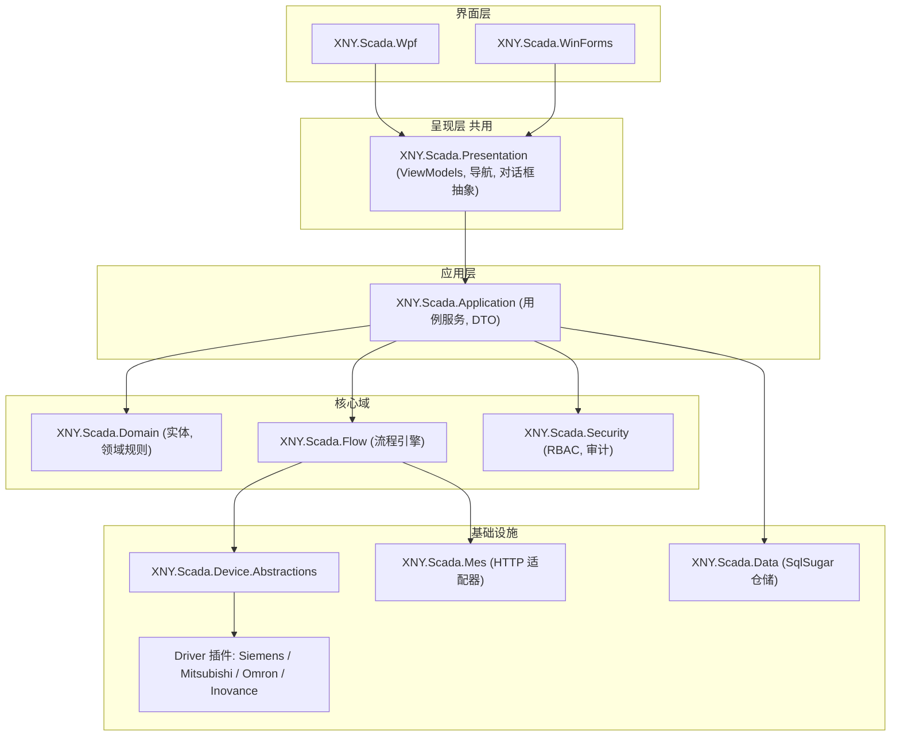
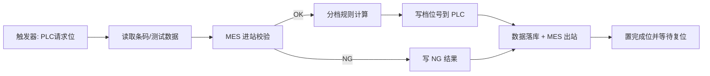

# 新能源单机 SCADA 系统设计方案

## 1. 总体目标与原则

- 一套核心，两套界面：业务逻辑、流程引擎、设备通讯、权限全部在与 UI 无关的类库中；WPF 与 WinForms 只做呈现层，共用 ViewModel。
- 配置优先：机型差异（组盘/拆盘/分档/NG挑选）通过"机型模板 = 点位模板 + 流程定义 + 业务参数 + 界面布局"描述，新增或变更工艺尽量只改配置，不改代码。
- 插件化扩展：PLC 驱动、流程节点、MES 适配器均以接口 + 插件程序集方式加载。
- 技术栈：.NET 8、CommunityToolkit.Mvvm、Microsoft.Extensions.Hosting（依赖注入/配置/日志）、SqlSugar（SQLite 默认，可切 SQL Server/MySQL）、HslCommunication、Serilog、NCalc（表达式）、Polly（重试）。

## 2. 分层架构



两套 UI 共用 ViewModel 的方式：.NET 8 的 WinForms 支持 `INotifyPropertyChanged` 绑定和 `Button.Command`，因此 ViewModel（`ObservableObject` + `RelayCommand`）可直接复用；对话框、导航、消息提示通过 `IDialogService`、`INavigationService`、`IUiDispatcher` 抽象，在各 UI 工程中分别实现。

## 3. 解决方案结构

```
XNYScada.sln
src/
  XNY.Scada.Domain              实体: 设备/点位/流程/产品/托盘/电芯/档位/用户/角色
  XNY.Scada.Device.Abstractions IPlcDriver, ITagProvider, 扫描组, 地址解析
  XNY.Scada.Device.Hsl          基于 HSL 的四类驱动实现(可拆成独立插件)
  XNY.Scada.Device.Runtime      连接管理, 轮询调度, 断线重连, 点位缓存, 变化事件
  XNY.Scada.Flow                流程定义模型, 解析器, 执行器, 内置节点
  XNY.Scada.Security            用户/角色/权限, 登录, 审计, 电子签名
  XNY.Scada.Data                SqlSugar 配置, 仓储, CodeFirst 迁移, 种子数据
  XNY.Scada.Mes                 可配置 HTTP 接口(请求模板/响应映射)
  XNY.Scada.Application         用例服务: 生产, 配方, 报警, 报表, 配置导入导出
  XNY.Scada.Presentation        共享 ViewModels
  XNY.Scada.Wpf                 WPF 界面(HandyControl 或 MaterialDesign)
  XNY.Scada.WinForms            WinForms 界面(原生控件 + 自绘仪表)
plugins/                        第三方/项目定制驱动与节点
configs/machine-templates/      组盘机/拆盘机/分档机/NG挑选机 模板 JSON
tests/                          单元测试 + PLC 模拟器集成测试
```

## 4. 设备管理模块

- 抽象接口（[src/XNY.Scada.Device.Abstractions](src/XNY.Scada.Device.Abstractions)）：

```csharp
public interface IPlcDriver : IAsyncDisposable
{
    string DriverKey { get; }               // "Siemens.S7", "Mitsubishi.MC", "Omron.FinsTcp", "Inovance.Tcp"
    Task<OperateResult> ConnectAsync(CancellationToken ct);
    Task<OperateResult<object>> ReadAsync(TagDefinition tag, CancellationToken ct);
    Task<OperateResult<object[]>> ReadBatchAsync(IReadOnlyList<TagDefinition> tags, CancellationToken ct);
    Task<OperateResult> WriteAsync(TagDefinition tag, object value, CancellationToken ct);
    bool IsConnected { get; }
}
[PlcDriver("Siemens.S7", DisplayName = "西门子 S7")]   // 插件发现特性
```

- 内置驱动（HSL 封装）：
  - 西门子：S7-200Smart/1200/1500/300/400（`SiemensS7Net`）
  - 三菱：MC 3E 二进制/ASCII、A1E（`MelsecMcNet` 等）
  - 欧姆龙：FINS TCP、CIP（`OmronFinsNet`、`OmronCipNet`）
  - 汇川：H3U/H5U/AM 系列（`InovanceTcpNet`）、Modbus TCP 兜底
- 扩展机制：`plugins/*.dll` 启动时扫描带 `[PlcDriver]` 的类型并注册；驱动参数用 `DriverOptionSchema` 描述，UI 动态生成参数表单。
- 点位模型：设备、点位组（扫描周期）、点位（地址、数据类型、字节序、字符串长度、缩放、读写属性、报警规则）；支持 Excel/CSV 导入导出。
- 运行时：每台设备独立通讯线程 + 批量读取合并、断线指数退避重连、点位值缓存与变化事件（`TagChanged`）、通讯诊断（耗时、失败率）。
- 报警：点位上的位报警/限值报警配置，报警历史与确认流程。

## 5. 流程模块（动态流程核心）

- 流程定义以 JSON 存储并带版本号，发布后不可修改，只能新建版本；运行时支持在空闲时热切换。
- 触发方式：PLC 信号上升沿、定时、手动、MES 回调、上一流程完成。
- 典型握手模式：PLC 置请求位 -> 上位读取数据 -> 业务处理 -> 写结果 -> 置完成位 -> 等待 PLC 清请求 -> 复位完成位，作为内置"握手"复合节点提供。

内置节点（`IFlowNode` 接口，可插件扩展）：

- 通讯类：读点位、写点位、等待信号（带超时）、PLC 握手
- 逻辑类：条件分支、Switch、循环、并行、子流程、延时、变量赋值（NCalc 表达式）
- 业务类：扫码/条码校验、电芯绑定托盘、托盘解绑、按规则计算档位、NG 判定、数据落库、MES 调用、报警触发、弹窗确认
- 高级：C# 脚本节点（Roslyn 脚本，需权限才能编辑）



- 流程上下文：变量作用域（全局/流程实例/工位），变量可引用点位 `{Tag:Dev1.Bin}`、配方参数 `{Recipe:MaxIR}`。
- 流程编辑器：WPF 版本提供拖拽式图形编辑器（基于 Nodify 或自研 Canvas）；WinForms 版本提供树形/表格式编辑器 + JSON 编辑，两者读写同一份 JSON。
- 运行监控：实例状态、当前节点高亮、每步耗时与输入输出日志、单步调试与模拟运行（使用模拟驱动）。

## 6. 机型模板（业务配置）

每个机型模板包含：点位模板、默认流程集、业务参数结构、主界面布局（工位/托盘矩阵/档位箱）。

- 组盘机：电芯扫码 -> MES 校验 -> 按托盘矩阵位置绑定 -> 满盘生成托盘号 -> 托盘上传。
- 拆盘机：托盘扫码 -> 查询托盘内电芯 -> 逐位取料确认 -> 解绑 -> 空托盘回流。
- 分档机：读取电压/内阻/容量 -> 按配方中的分档规则表（区间、优先级、表达式）计算档位 -> 写档位号 -> 档位计数与满箱提醒。
- NG 挑选机：读取 NG 信息（来自 MES 或上游数据）-> 匹配 NG 原因代码 -> 剔除到对应 NG 料盒 -> NG 统计。
- 配方管理：按产品型号管理参数与分档规则，带版本、审批与切换记录。

## 7. 权限模块

- RBAC：用户 - 角色 - 权限，权限粒度分为菜单、页面、按钮/操作、数据（设备/工位范围）。
- 权限点由代码特性 `[Permission("Device.Edit")]` 声明并自动同步到数据库，ViewModel 命令执行前统一校验，UI 通过 `IPermissionService` 绑定可见/可用状态。
- 默认角色：操作员、技术员、工程师、管理员、超级管理员（内置不可删除）。
- 登录：账号密码（PBKDF2 加盐）、刷卡登录（串口/HID 读卡器）、自动登出超时、密码策略、锁定策略。
- 审计：登录、参数修改（记录旧值/新值）、流程发布、配方切换、手动写 PLC，全部进审计表；关键操作支持二次身份确认（电子签名）。

## 8. 数据与 MES

- SqlSugar CodeFirst，按 `DbType` 配置切换 SQLite/SQL Server/MySQL；生产数据表按月分表，设置数据保留策略与归档。
- 主要表：用户/角色/权限、设备/点位/报警、流程定义/版本/实例日志、配方/分档规则、托盘/电芯绑定、生产记录、NG 记录、报警历史、审计日志、MES 调用日志。
- MES：接口以配置描述（URL、方法、请求模板、响应字段映射、成功判定表达式、超时重试），流程中通过"MES 调用"节点引用；支持离线缓存与断网补传。

## 9. 界面功能清单（两版一致）

登录、主监控（设备状态、工位、托盘矩阵/档位、实时产量 OEE）、报警中心、设备与点位配置、通讯诊断、流程设计与监控、配方与分档规则、生产数据查询与导出、MES 配置与日志、用户角色权限、审计日志、系统参数。

## 10. 分阶段实施

- 第 1 阶段：解决方案骨架、依赖注入宿主、日志、SqlSugar 数据层、领域实体。
- 第 2 阶段：设备抽象 + 四类 HSL 驱动 + 模拟驱动 + 运行时轮询与报警。
- 第 3 阶段：权限模块（RBAC、登录、审计）。
- 第 4 阶段：流程引擎（定义、执行器、内置节点、版本发布、监控）。
- 第 5 阶段：MES 适配器与配方/分档规则。
- 第 6 阶段：共享 ViewModel + WPF 界面（含图形流程编辑器）。
- 第 7 阶段：WinForms 界面（复用 ViewModel）。
- 第 8 阶段：四个机型模板及模拟器下的端到端测试、安装打包。